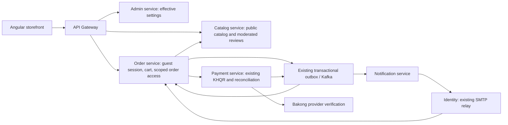

# Guest commerce implementation

## Repository inspection and decisions

The frontend is `/home/senghour/Desktop/Order_Shop_Frontend`; the microservice repository is `/home/senghour/Desktop/E-Shop`.

| Area inspected | Existing behavior | Implementation |
| --- | --- | --- |
| Identity / Spring Security / JWT | Registered login, cookie sessions, role and live function permissions; customer-owned addresses | Retained. Guests are not Identity accounts. Reuse the mail sender for a fixed verification template. |
| Gateway | JWT/account-cookie authentication, trusted-Origin checks, dynamic routes, circuit breakers | Narrow public storefront and guest routes; guest requests receive static, fail-closed Redis rate limits. Private customer/admin routes remain protected. |
| Catalog / Product / ProductSku | Active products, SKU presentation, authoritative promotion quotes, locked stock reservations | Public active-only presentation; reuse the existing quote/reserve/confirm/release implementation with explicit guest ownership. |
| Cart | Cart and CartItem belong to a registered user | Reuse both entities and CartServiceImpl. A cart belongs to exactly one customer or guest session. |
| Orders | Durable CheckoutCoordinator, checkout keys, recovery job, immutable SKU price snapshots | Reuse coordinator and OrderDetail/OrderItem. Guest ownership and immutable delivery/contact snapshot replace an Identity address reference. |
| Payments / ABA / KHQR | Outbox-driven dynamic QR generation, server-to-server provider verification, expiration, late-payment reviews and reconciliation | Reused. Guest transactions have no customer ID; they belong to an authoritative order. Scoped guest credentials are checked by order-service before internal payment reads. |
| Notifications | Kafka events, outbox, notification service and Identity SMTP relay | Add a guest notice topic containing references only. SMTP resolves the verified recipient from the order. No email address or token is placed in Kafka. |
| Angular storefront | Product details/cart/checkout required sign-in; review submission was disabled | Feature-aware guards, guest cart, contact/address checkout, KHQR/status/receipt and guest order history. Signed-in checkout keeps its existing component and endpoints. |
| ShopAdmin | Store contact settings; preview-only guest UI | Persisted Storefront Access screen, guest-order filter and snapshot details, guest payment labels, review moderation and guest creation audit view. |
| Database upgrades | Service-specific SQL files in `src/main/resources/db/upgrade`; no migration runner was present | Follow that existing convention. Apply the new SQL upgrades explicitly; do not rely on Hibernate to install database checks. |

No guest profile, guest address, guest cart or fake user entity duplicates the existing domain model. Delivery data lives only in the guest order context and is never returned through customer address APIs.

## Service boundaries



Order-service owns guest sessions. Neither gateway nor catalog/payment services manufacture authenticated principals for guests. Cross-service UUID references are not foreign keys across databases. Local cart/order/access references are constrained in order_db.

Customer commerce events retain version 1. A guest commerce event uses version 2 with `userId: null`; its order ID resolves the authoritative guest owner. Upgrade every commerce-event consumer before enabling guest checkout. Notification recipients for registered users remain unchanged.

## Effective settings and permissions

`GET /api/v1/storefront/access-settings` exposes only eight booleans, with `Cache-Control: no-store`. Settings are read from admin_db without cross-request caching. Missing settings use these defaults:

```json
{
  "guestBrowsing": true,
  "guestReviews": false,
  "guestCart": false,
  "guestCheckout": false,
  "guestPayment": false,
  "requireDeliveryAddress": true,
  "requireGuestContactVerification": false,
  "guestOrderTracking": false
}
```

Admin endpoints:

- `GET /api/v1/admin/storefront/access-settings`: live `STOREFRONT_ACCESS_VIEW` permission.
- `PUT /api/v1/admin/storefront/access-settings`: live `STOREFRONT_ACCESS_UPDATE` permission.
- `GET /api/v1/admin/guest-reviews`, `PUT /api/v1/admin/guest-reviews/{id}`: live `PRODUCT_REVIEW_MODERATE` permission.

Permissions are defined without granting them to existing groups. Existing administrator accounts receive active function definitions through the existing permission resolver. Delegated staff need explicit grants. Physical delivery addresses cannot be disabled. Online guest payment requires checkout; checkout requires a cart. COD remains available when checkout is enabled; `guestPayment` controls online ABA/KHQR payment.

Disabling online guest payment blocks initiation and QR image reads and removes payable QR data from guest status responses. Already-issued transfers still reconcile; turning a switch off cannot recall a QR already copied into a banking app.

## Sessions, ownership and abuse controls

- A CSPRNG generates 256-bit opaque session tokens. PostgreSQL stores SHA-256 hashes, never the raw tokens.
- The cookie is HttpOnly, host-only, `Secure` by default, `SameSite=Lax`, and scoped to `/api/v1/guest`. It contains no contact information.
- Absolute lifetime: seven days. Bootstrap rotates both the session token and CSRF secret while keeping the server-side owner and original expiry. Revocation expires the row and cookie.
- Every guest mutation checks an exact trusted Origin and a session-bound `X-Guest-CSRF` secret. Bootstrap checks Origin before issuing cookies. Duplicate Origin headers and cross-site requests are rejected.
- CSRF secrets are held in Angular memory; guest order credentials are held in the order component's memory. Credentials are not placed in URLs. Only a non-sensitive checkout idempotency key is kept in sessionStorage for uncertain retries.
- Guest order access requires both the session cookie and a random per-order `X-Guest-Order-Token`. Only its hash is stored. Lifetime is one hour; renewal requires session ownership. Order numbers alone grant no access.
- Confirmation access remains available for fifteen minutes after checkout, including when general guest history is disabled. After that, guest order tracking must be enabled.
- Gateway: 30 session bootstraps/hour/IP and 240 guest operations/minute/IP, including when dynamic route limiting is disabled. Redis outages deny these operations. Order-service additionally applies per-session and per-contact quotas.
- Email verification: eight random digits, five-minute expiry, one-time atomic consumption, five attempts/five minutes and limited sends per session/email. Only the challenge hash is stored in Redis.
- Guest reviews require verified contact, have per-session and per-email daily quotas, reject links/embedded script markup, allow one submission/product/owner, and remain PENDING until moderation. Purchase badges come from delivered orders; sign-in is never purchase evidence.
- Idempotency keys, cart row locks, a unique `(guest_session_id, checkout_key)` index and existing durable catalog operations prevent duplicate orders and reservations. Stock and prices come from catalog-service, not Angular.

## APIs and frontend routes

Paths follow the existing `/api/v1` convention. Guest operations never accept a browser-supplied owner ID.

| Method | Endpoint | Purpose |
| --- | --- | --- |
| GET | `/api/v1/storefront/products?page=1&size=12&search=` | Active guest product page; optional category name |
| GET | `/api/v1/storefront/products/{id}` | Active product details |
| GET | `/api/v1/storefront/skus/{id}` | Active SKU's product presentation |
| GET | `/api/v1/storefront/categories` | Public categories |
| GET | `/api/v1/storefront/products/{id}/reviews` | Approved public reviews only |
| POST / DELETE | `/api/v1/guest/session` | Bootstrap/rotate or revoke guest session |
| GET | `/api/v1/guest/cart` | Guest basket and server-priced summary |
| POST | `/api/v1/guest/cart/items` | Add SKU and quantity |
| PATCH / DELETE | `/api/v1/guest/cart/items/{id}` | Change quantity or remove an owned item |
| DELETE | `/api/v1/guest/cart/items` | Clear owned basket |
| POST | `/api/v1/guest/contact/code` | Send fixed verification template |
| POST | `/api/v1/guest/contact/verify` | Verify and consume code |
| POST | `/api/v1/guest/checkout/preview` | Validate details and obtain authoritative quote |
| POST | `/api/v1/guest/orders` | Idempotent order creation |
| GET | `/api/v1/guest/orders` | Up to 50 recent orders owned by this session |
| POST | `/api/v1/guest/orders/{id}/access` | Issue/renew scoped access for an owned order |
| GET | `/api/v1/guest/orders/{id}` | Redacted confirmation/shipping status |
| POST | `/api/v1/guest/orders/{id}/payments` | Idempotent access to existing outbox-initiated payment |
| GET | `/api/v1/guest/orders/{id}/payment-status` | Provider-authoritative payment status |
| GET | `/api/v1/guest/orders/{id}/payment-image` | Non-expired payable QR image |
| POST | `/api/v1/guest/reviews` | Verified-contact review submission |

Customer routes: `/shop`, `/shop/:id`, `/cart`, `/checkout`, `/guest/orders`, `/guest/orders/:id`. Registered customers keep their existing account/order routes. Admin routes: `/admin/storefront-access`, `/admin/orders` (Guest orders only), `/admin/orders/:id`, existing payment details, `/admin/guest-reviews`, `/admin/guest-activity`.

Delivery fields: full name, phone, optional/verified email as configured, province, district, commune, village, street/house and delivery notes. A valid address is mandatory even if a malicious client changes a switch in its request.

See [sample requests](sample-requests.json) for bodies. Status codes include 401 for missing/expired sessions, 403 for disabled features/origin/CSRF/permission failures, 404 for unauthorized scoped order access, 409 for conflicts, 428 for required verification and 429 for rate limits. Existing API error envelopes remain in use. QR preparation can temporarily return a not-ready response; the UI retries while the existing outbox worker generates it.

## Retention and privacy

`GuestRetentionService` runs daily at 03:20 in the service timezone:

- Expired per-order access credentials are deleted.
- Verified session contact is erased 30 days after session expiry.
- Expired, unlocked guest carts and their items are deleted after 30 days. Sessions without retained orders/carts are then deleted.
- Delivery snapshots and the verified order email are redacted 90 days after creation for terminal DELIVERED/CANCELLED/FAILED/REFUNDED orders. Open fulfillment/payment disputes keep their details until terminal.
- Non-personal order, inventory, payment and audit records remain for reconciliation. Published review content and its chosen public display name remain public after approval; they contain no private verified email or delivery address.

Tracking responses exclude contact/address data. Notification Kafka events exclude personal data. Confirmation emails go only to the verified address captured on that order and are deduplicated by event ID. As with the existing sender, SMTP has an acknowledgement/crash window where exact-once external delivery cannot be guaranteed. Configure infrastructure/SMTP log retention separately; application SQL redaction cannot erase external logs or backups.

## Deployment order

No live shop migration or deployment is performed by the implementation tests.

1. Keep guest checkout/payment disabled. Back up affected databases using the existing operations procedure.
2. Apply each service's `20261019_*.sql` files to its own database. Auth has two files (permission definitions and guest mail delivery ledger). The upgrades are idempotent; review and resolve invalid legacy ownership rows before adding checks. Do not remove checks to work around bad data.
3. Build/deploy common-lib consumers and changed admin, auth, catalog, order, payment, notification and gateway services together. This is required before publishing version-2 guest commerce events.
4. Include `compose.guest.yaml` after the base/AI configuration. For local HTTP, place `compose.local.yaml` after it; that override explicitly disables Secure only for the local guest cookie. Production must use HTTPS and `GUEST_COOKIE_SECURE=true`.
5. Set `GATEWAY_CORS_ORIGINS` to exact trusted frontend origins, including ports. `GUEST_ALLOWED_ORIGINS` must match. `STOREFRONT_ADMIN_URL` points order/catalog/payment services to admin-service. Keep individual services off public ingress.
6. Enable the existing commerce automation, Kafka/outbox tables, reconciliation, merchant configuration and notification infrastructure. Existing KHQR deployment prerequisites still apply.
7. Deploy Angular. Grant the new view/update/moderation permissions deliberately, then enable guest features in Storefront Access. Check registered checkout before and after enabling.

Example local composition (append the existing SMTP override if needed):

```bash
docker compose --env-file .env.local -f compose.yaml -f compose.ai.yaml -f compose.guest.yaml -f compose.local.yaml up -d
```

Do not run the example until database upgrades and service builds are ready. It is documentation, not a deployment performed by this task.

## Validation and remaining boundaries

Actual commands and results are recorded in [verification](verification.md). The application smoke verifier boots production classes with disposable Redis/H2 and a local settings HTTP fixture. The PostgreSQL migration verifier creates a network-isolated disposable container and imports only schema from local databases. It never copies customer rows or writes to the source databases.

Known boundaries:

- Guest recovery is same-browser/cookie only. Cross-device email recovery, phone/SMS verification and cart merge on login are not implemented.
- Guest payment reuses the existing Bakong-backed KHQR adapter (including compatible ABA banking apps); this does not add a separate ABA PayWay integration.
- An expired QR is never revived. Existing reconciliation cancels/releases stock after a verified negative outcome; a customer starts a fresh checkout after that outcome. Generating a new payment attempt for the same cancelled order is intentionally unsupported.
- Live provider money movement, real SMTP delivery, and a complete multi-service browser checkout have not been executed by these tests. Provider verification tests use controlled responses; stock tests and migration checks use real disposable PostgreSQL.
- Rotating bootstrap invalidates another tab's in-memory CSRF secret. Reload that tab before retrying a mutation. The cookie owner and absolute session expiry remain unchanged.
- Full frontend test compilation is currently blocked by an existing access-groups test using removed customer-form properties. The focused guest/checkout/payment/session tests can be run independently.
